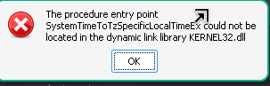

# How the launch fix works

[Back to the README](../README.md)

## What is going wrong?

When launching ArcheAge Chronicles on Linux through Steam, you may see this error instead of the game:

> The procedure entry point SystemTimeToTzSpecificLocalTimeEx could not be located in the dynamic link library KERNEL32.dll.

This is the original screenshot from the launch failure that led to this fix.

The message sounds like a missing game file, but the problem we found is in the Windows compatibility software. **Proton** is the software Steam uses to run Windows games on Linux. It includes Wine, which provides Linux-compatible versions of Windows functions that games expect.

During startup, software used by the game looks for a function called `SystemTimeToTzSpecificLocalTimeEx` in `KERNEL32.dll`, one of those Windows-compatible libraries. That function converts a standard reference time (UTC) into local time, accounting for time zones and daylight saving rules.

In the Proton version we tested, the function is missing from that library. Another library has an entry with the right name, but it is only a placeholder, not a working implementation. Simply pointing to that entry would not solve the problem.

This does not mean your computer's clock is wrong. Changing your time zone or downloading a replacement Windows DLL is not the fix.

## What does the fix change?

Think of Proton as a translator with one missing phrase. This workaround adds that phrase, using time-zone features the translator already understands.

The installer:

1. **Makes a separate copy of your chosen Proton version.** Your shared Proton installation stays unchanged, so other games using the original version are unaffected.
2. **Backs up this game's Windows settings and saves.** Proton keeps a Windows-style environment for each game, called a *prefix*. The installer backs up that environment before adding the helper.
3. **Adds a small helper file, `tzcompat.dll`, to this game's environment.** It supplies the missing time conversion using existing Wine functions, including support for daylight saving and historical time-zone rules. It does not change your system clock or time-zone setting.
4. **Connects the missing function to the helper.** Only the private Proton copy's `kernel32.dll` is patched to direct requests for that function to `tzcompat.dll`.
5. **Adds a separate Proton option in Steam.** You select **Proton ArcheAge TZ Fix (experimental)** for this game to use the workaround.

The included helper is built from this repository's source code. You do not need a compiler to install it. The installer refuses to overwrite an existing private runtime, backup, or helper file.

## What does it leave alone?

The workaround does not patch game files or anti-cheat files, and it does not disable or bypass anti-cheat. It also does not replace your shared Proton installation or install Microsoft's Windows DLLs.

It addresses this specific missing-function error. It is not a general performance fix or a promise that every launch, graphics, or online-play issue will be resolved.

## Has it worked in practice?

Testing on **CachyOS with native Steam** and **proton-cachyos-11.0-20261015 (steam linux runtime)** got past the error, reached shader compilation, and allowed entry into the game. A separate test program also checked the helper's time conversions.

That is a result for one tested setup, not a guarantee for every Linux system or Proton version. The workaround supports Linux x86-64; Flatpak Steam is unsupported. Future game, Proton, or anti-cheat updates may change whether it works. **There is no guarantee of anti-cheat acceptance or account safety.**

## Can I undo it?

Yes. Exit the game and select your original Proton version in **Steam → ArcheAge Chronicles → Properties → Compatibility**. The original Proton does not use the added helper.

Keep the backup until you are satisfied with the result. Restoring an older backup can replace newer settings or saves, so read the [cleanup and restoration instructions](advanced.md#roll-back) before removing files or restoring anything.

## Next steps

- [Install the fix](../README.md#install)
- [Troubleshoot an installation or launch problem](troubleshooting.md)
- [Read the technical explanation and manual instructions](advanced.md#what-it-does)
